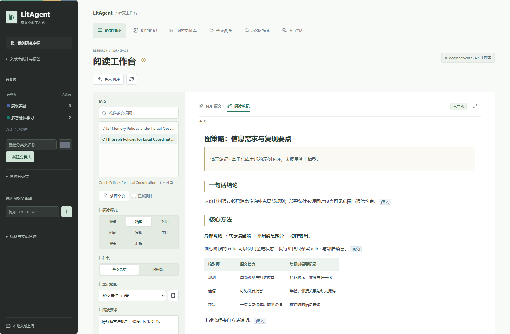
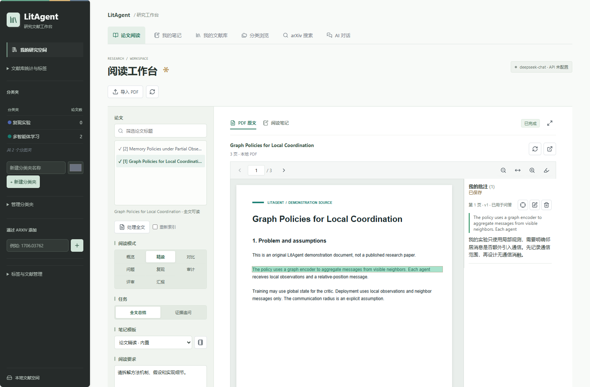
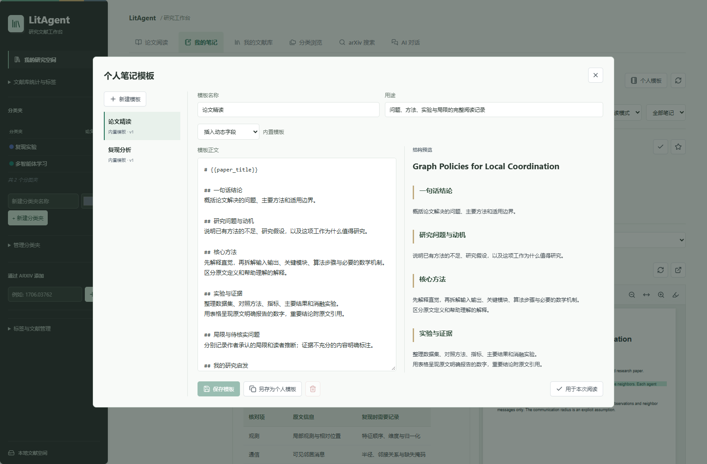
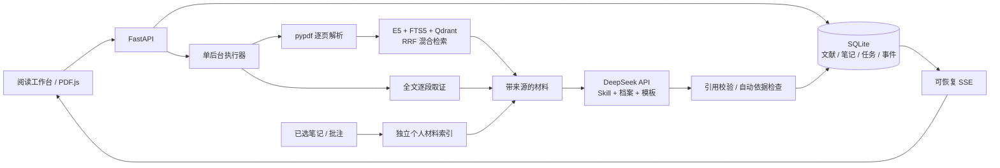

# LitAgent


[MIT License](LICENSE)

**以论文原文为依据，结合个人的阅读方式与个人笔记。**

LitAgent 是面向个人研究工作流的论文阅读 Agent：导入 PDF 或 arXiv 论文，进行全文精读和证据追问，检查引用位置，将结果沉淀为可编辑笔记，再让经过你选择的笔记与批注参与下一次阅读。

项目使用 **DeepSeek API、全文混合 RAG、版本化 Skills、个人笔记模板和可恢复任务流程**。



> 截图由独立演示数据库生成，展示真实界面与交互；

## 能做什么

| 工作环节 | 当前实现 |
|---|---|
| 配置模型 | 页面填写 API 地址、模型与密钥，测试连接、保存或恢复环境配置 |
| 收集论文 | arXiv 搜索与导入、本地 PDF 上传、分类夹、标签、BibTeX 导出 |
| 阅读全文 | 逐页解析、分块取证、汇总生成；具体问题走混合检索 |
| 检查依据 | 原文片段与 PDF 页码链接、引用 ID 校验、有范围的自动依据检查 |
| 调整阅读方式 | 8 种阅读 Skill、持久化研究档案、个人模板、20 个动态字段 |
| 沉淀笔记 | 笔记库、正文版本、收藏、回收站、Markdown / PDF 阅读包导出 |
| 融入个人理解 | PDF 高亮与批注、历史修订、明确选择的笔记版本参与 RAG |
| 追踪任务 | SQLite 任务和事件、SSE 阶段与输出、取消、重试、检查点恢复 |

### 从批注到下一次问答



在 PDF 中选中文字并写下自己的疑问或研究条件。阅读时开启“结合已选个人笔记与批注”，系统分别检索论文和个人材料，回答中区分 **[原文]** 与 **[个人笔记]**。

笔记正文编辑后，需要重新选择最新版本；停用、删除或过期的材料不参与新的检索。已有答案保留生成时的来源快照。

### 你的笔记，按你的结构



内置“论文精读”和“复现分析”两版模板，也支持从空白创建自己的章节结构。模板负责输出组织，Skill 负责分析流程，阅读档案负责解释深度与研究条件；三者都不能覆盖原文证据规则。
同时可以手动修改优化笔记内容，本地会保存多个版本，方便对比与回溯笔记

## 技术结构



| 层 | 技术 |
|---|---|
| 服务与数据 | Python 3.12、FastAPI、Pydantic、SQLAlchemy、SQLite WAL / FTS5 |
| 全文处理 | pypdf、SHA-256 文件标识、解析与索引版本 |
| 检索 | multilingual-e5-small、sentence-transformers、Qdrant 本地持久化、BM25、RRF |
| 模型与执行 | DeepSeek OpenAI 兼容接口、服务端工具参数校验、执行预算、任务检查点 |
| 前端 | 原生 JavaScript / CSS、PDF.js、Lucide、Marked、DOMPurify |
| 验证与运行 | pytest、Playwright、Docker Compose 配置、GitHub Actions |

具体分块、检索配额、版本失效和恢复逻辑见 [技术设计](docs/TECHNICAL_DESIGN.md)。

## 快速开始

推荐 Python 3.12。完整阅读需要一个可用的 DeepSeek API 密钥，以及首次下载本地嵌入模型所需的网络和磁盘空间。

### Windows PowerShell

```powershell
git clone https://github.com/S1mmp1e/Litagent.git
cd Litagent
py -3.12 -m venv .venv
.\.venv\Scripts\python.exe -m pip install -r requirements-rag.txt
Copy-Item .env.example .env
```

密钥可以在启动后通过页面配置；也可以提前在本机 `.env` 中设置 `DEEPSEEK_API_KEY`。然后执行：

```powershell
.\.venv\Scripts\python.exe -m scripts.setup_embeddings
.\.venv\Scripts\python.exe -m scripts.launch
```

打开 `http://127.0.0.1:7860`，点击右上角“模型设置”，填写自己的 API Key、API 地址和模型名称，先“测试连接”再“保存配置”。未配置时页面会显示提示。以后也可双击 `start_webui.bat`。启动器会检查依赖、端口及数据库身份，**不会自动安装依赖或下载模型**。

### Linux / macOS

```bash
git clone https://github.com/S1mmp1e/Litagent.git
cd Litagent
python3.12 -m venv .venv
.venv/bin/python -m pip install -r requirements-rag.txt
cp .env.example .env
# 密钥可在启动后的“模型设置”中填写，也可使用 .env
.venv/bin/python -m scripts.setup_embeddings
.venv/bin/python -m scripts.launch --no-browser
```

Windows 本机流程已有实际验证；跨平台测试由 CI 检查，Docker 配置与平台说明见 [部署指南](docs/DEPLOYMENT.md)。

### 配置模型 API

- 右上角“模型设置”可填写 API 地址、模型名称和 API Key，窗口提供 DeepSeek 密钥管理入口。
- “测试连接”只请求服务商的 `/models`，不发送论文、不调用生成接口；成功不代表余额充足或所有阅读功能均兼容。返回的模型名称可在输入框中选择。
- “保存配置”后新任务立即生效，正在运行的任务继续使用原配置。密钥留空会保留现有密钥；更换 API 地址时须重新填写该服务的密钥。
- 配置优先级为：**界面保存的本机配置 > 进程环境变量 > `.env` > 默认值**。可点击“恢复环境配置”移除界面配置。
- 界面配置以明文保存在 `LIT_DATA_DIR/model-config.json`（默认 `data/model-config.json`）；不返回密钥，不写入浏览器存储，并排除在 Git 发布范围外。

> 只安装 `requirements.txt` 可以运行文献管理和界面；全文索引与语义检索需要 `requirements-rag.txt` 及本地模型。首次安装会下载 PyTorch 等较大依赖。


## 第一次完整使用

1. 在“模型设置”保存自己的 API 配置，然后在“论文阅读”导入文字型 PDF，等待“处理全文”完成。
2. 保存阅读档案，选择“精读”等阅读模式和笔记模板。
3. 开始全文阅读，检查结果中的引用并对照 PDF。
4. 在“我的笔记”修改、保存自己的理解；需要复用时勾选“将此版本用于后续问答”。
5. 在 PDF 中添加批注，切换“证据追问”，开启个人材料后继续提问。

完整操作、双论文对比、备份和故障处理见 [用户手册](docs/USER_GUIDE.md)。

## 开发与验证

```powershell
.\.venv\Scripts\python.exe -m pip install -r requirements-dev.txt
.\.venv\Scripts\python.exe -m pytest -q
npm ci
npx playwright install chromium
npm run test:annotations-ui
```

## 文档导航

| 文档 | 内容 |
|---|---|
| [用户手册](docs/USER_GUIDE.md) | 首次 API 配置、完整使用流程与常见问题 |
| [技术设计](docs/TECHNICAL_DESIGN.md) | 架构、模型配置、RAG、Skills、个人材料与数据一致性 |
| [开发指南](docs/DEVELOPMENT.md) | 本地开发、目录职责、扩展方式、测试和提交检查 |
| [部署指南](docs/DEPLOYMENT.md) | 配置、单进程限制、Docker、模型准备、备份恢复 |
| [API 参考](docs/API_REFERENCE.md) | 模型设置、阅读与笔记接口、SSE、冲突与错误语义 |
| [演示与技术展示](docs/SHOWCASE.md) | 关键画面、可复现演示、技术讲解路线 |
| [验证与评测](docs/VALIDATION.md) | 软件检查、真实质量评测与证据边界 |
| [MIT 许可证](LICENSE) | 自有代码及文档的使用、修改与分发许可 |
| [第三方声明](THIRD_PARTY_NOTICES.md) | 随仓库分发的前端依赖及许可证位置 |

## 当前边界

- 面向本机单用户；没有账号和公网访问认证。一个数据目录只启动一个服务进程。
- pypdf 处理文字型 PDF；不支持 OCR，也不承诺复杂公式、表格或图片的可靠理解。
- 阅读选择最多两篇论文；不是任意规模的跨库综述系统。
- 自动引用检查可能出错，不替代人工核对。

## 许可证

LitAgent 的自有代码及文档采用 [MIT 许可证](LICENSE)，允许使用、修改、分发和商业使用，分发时须保留版权及许可声明。

随附第三方代码和资源遵循各自许可证，详见 [第三方声明](THIRD_PARTY_NOTICES.md)。根目录的 MIT 许可证不替代这些依赖的许可条款。
