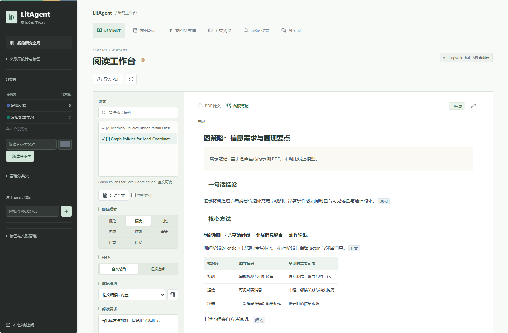
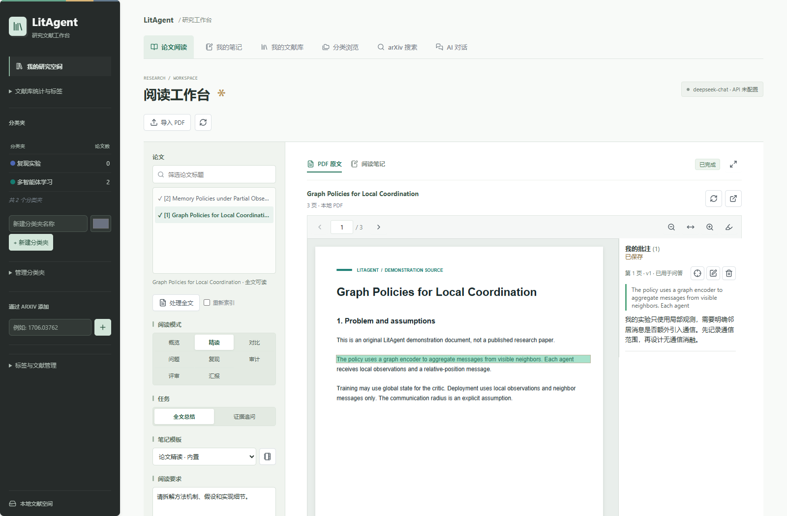
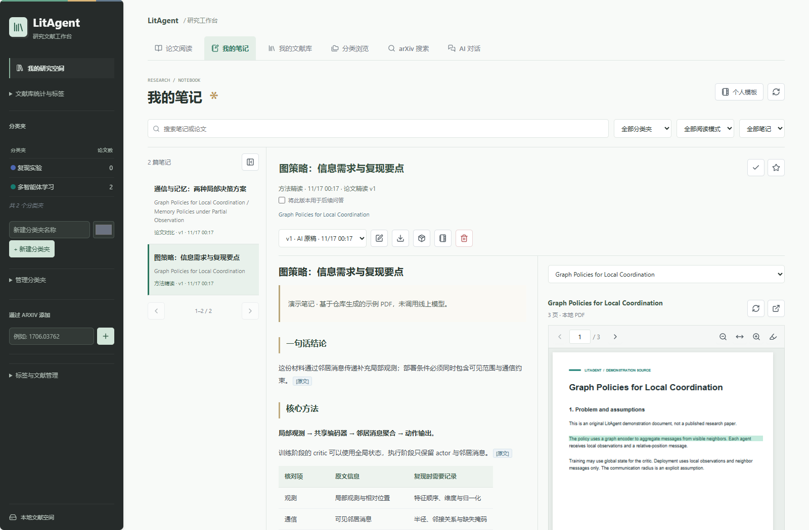
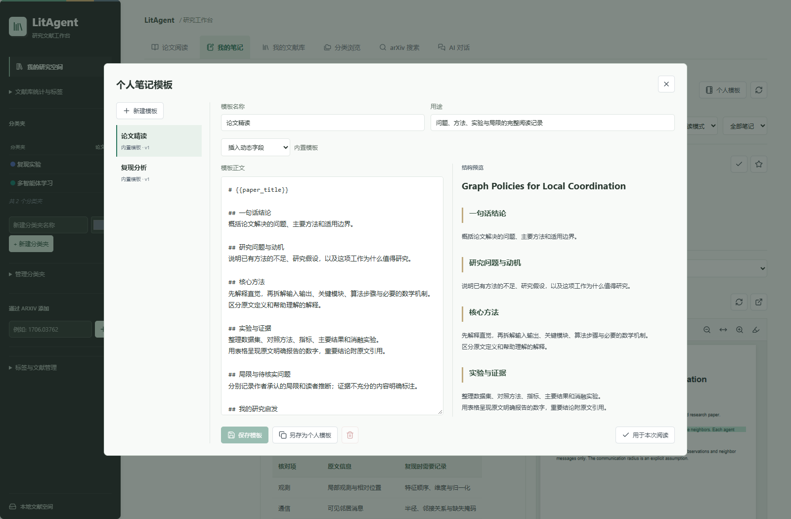
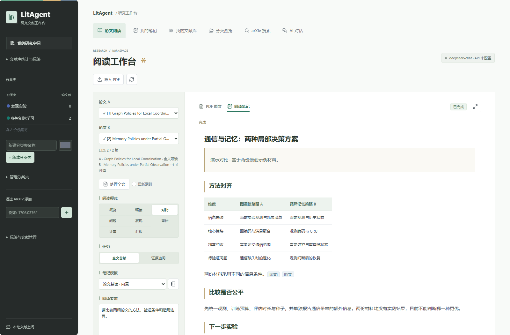
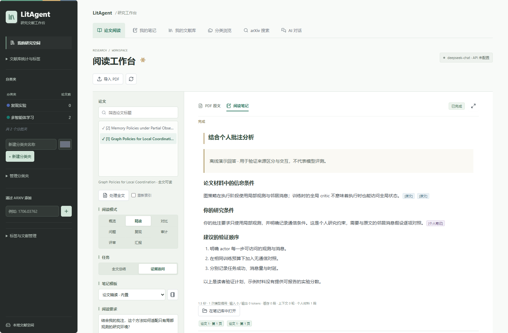
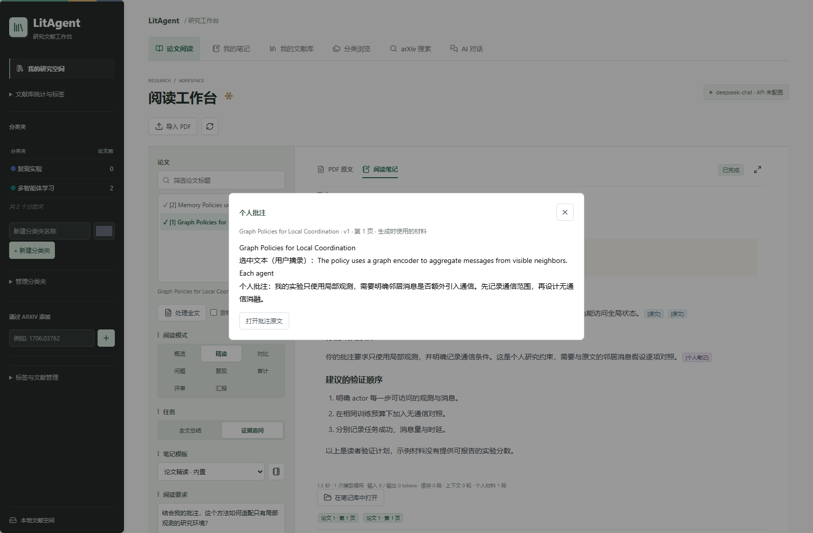
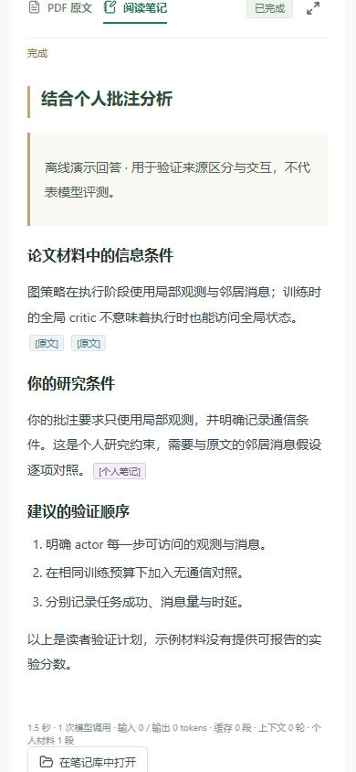

# 演示与技术展示

这组画面来自实际运行的 LitAgent。截图脚本创建独立数据库、两份原创示例 PDF 和离线回答，不连接 DeepSeek，也不读取个人文献库。它展示软件功能与数据流，不提供真实模型效果或研究结论。

## 1. 从论文到阅读笔记



选择论文、阅读模式和模板，查看带引用的结构化结果。完整阅读逐段处理全文；具体追问使用检索材料。模板决定章节结构，Skill 决定分析步骤，阅读档案补充背景和研究条件。

讲解重点：为什么全文总结不能等价于只取几个 top-k 片段；为什么要保存本次使用的 Skill、档案和模板版本。

## 2. 阅读 PDF 并添加批注



在文字上添加高亮、评论和颜色，点击批注定位原页。批注保存在数据库中，不改写原始 PDF。页码与文档版本共同定位来源；坐标保存为 PDF 空间矩形，显示时经 PDF.js viewport 转换；修订采用版本和并发冲突检查。

## 3. 笔记与原文并排查看



在“我的笔记”修改正文、查看历史、收藏、筛选、移入回收站或导出阅读包。笔记保存生成时的论文来源，后续更新论文不会悄悄改变旧笔记的依据。正文版本与来源快照分开，删除和恢复与个人检索资格保持一致。

## 4. 设计个人模板



两个内置模板提供起点，用户可另存个人模板。20 个动态字段覆盖论文元数据、阅读档案与当前任务，在光标位置插入并在预览中解析。保存创建新版本，任务记录实际使用的版本。

模板负责输出组织，不能覆盖证据约束。界面处理切换、晚到请求和草稿清空，防止旧内容覆盖新编辑。

## 5. 对齐两篇论文



切换“对比”后分别选择论文 A 和 B。结果按方法、信息条件、实验设置与适用边界比较，引用保留各自论文身份。材料没有报告结果时明确缺失，不生成排名或胜负结论。

## 6. 个人材料参与问答





开启个人材料后，系统分别查找论文原文和用户明确选择的笔记、批注。两类来源使用不同引用样式。点击个人引用显示生成时保存的具体版本，而不是后来修改过的正文。

用户判断不能冒充作者结论；修改、撤回、删除后的内容不能继续进入新回答。检索前后检查有效版本，避免并发修改混入过期内容。

## 7. 手机阅读



浏览器测试检查手机宽度下的横向溢出和主要交互，不等同于所有设备兼容认证。

## 8. 首次配置与切换模型

点击右上角“模型设置”，填写服务地址、模型名称和 API Key，依次测试连接、保存。未配置时会显示入口提示，提交阅读或对话会先引导配置，并保留已输入的问题。重新打开窗口只显示配置来源和密钥是否存在，不回显密钥。

讲解重点：连接测试只查询模型列表，实际阅读的余额、配额和接口兼容性仍需验证；保存配置影响随后创建的客户端，运行中的客户端不切换。“恢复环境配置”移除页面覆盖，不修改 `.env`。

这一交互单独由 `npm run test:settings-ui` 使用本机模拟服务验证，包括认证失败和桌面、手机布局；截图保存在本机 `artifacts/ui/`，不包含在下面八张公开阅读演示图中。公开展示时使用测试生成的模拟配置，避免展示自己的密钥输入。

## 复现这些画面

在项目目录安装开发依赖与浏览器：

```powershell
.\.venv\Scripts\python.exe -m pip install -r requirements-dev.txt
npm ci
npx playwright install chromium
npm run showcase
```

Linux / macOS 使用 `.venv/bin/python` 安装 Python 依赖，其余命令相同。脚本优先使用 Windows 已安装的 Edge，否则使用 Playwright Chromium；也可用 `LIT_BROWSER_PATH` 指定浏览器。

入口为 [showcase.cjs](../scripts/showcase.cjs)，生成器是 [showcase_fixture.py](../scripts/showcase_fixture.py)，离线服务是 [showcase_server.py](../scripts/showcase_server.py)。

1. 创建 `.notebook-test-showcase-*` 临时数据目录，显式清空模型密钥环境变量。
2. 生成原创示例 PDF，经真实解析流程建立文档与片段；使用确定性模拟向量，不下载嵌入模型。
3. 用浏览器执行论文选择、批注、模板、对比、问答和引用查看。
4. 检查浏览器错误、PDF 非空像素和手机溢出，将八张截图写入 `docs/images/`。
5. 停止演示服务，清理经路径校验的临时目录。

这些脚本只用于开发与展示，不作为生产入口。离线画面中的时间、调用与 Token 计数不能用于性能报告。

## 五分钟讲解路线

| 时间 | 展示 | 说明 |
|---|---|---|
| 0:00–0:45 | 阅读工作台 | 用户目标、选择、模式与输出 |
| 0:45–1:45 | 引用与 PDF | 分块、混合检索、来源定位 |
| 1:45–2:30 | Skills 与模板 | 分析流程、档案、输出结构的分工 |
| 2:30–3:30 | 批注与个人问答 | 版本选择、撤回和快照 |
| 3:30–4:15 | 任务与历史笔记 | 持久化事件、恢复边界 |
| 4:15–5:00 | 验证结果 | 软件检查、真实评测方法、限制 |

技术细节见 [技术设计](TECHNICAL_DESIGN.md)，证据边界见 [验证说明](VALIDATION.md)。
