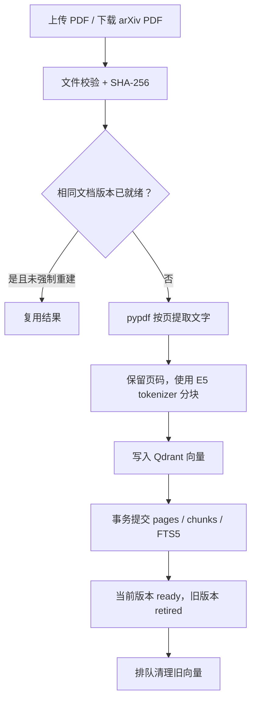
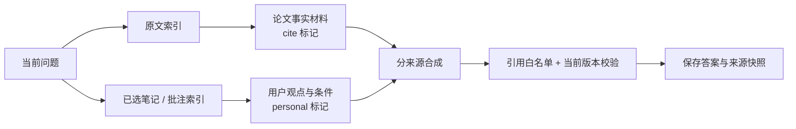
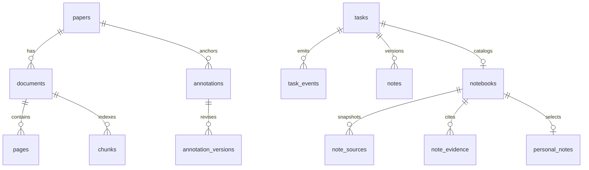

# 技术设计

本文描述仓库当前实现。早期 v3/v4 文档用于历史追溯，当前入口以本文及源码为准。

## 1. 系统边界

LitAgent 是本机单用户论文阅读应用。FastAPI 提供文献、阅读、笔记和批注接口；一个后台线程串行执行持久化任务；SQLite 是业务状态的权威来源，Qdrant 是可重建的检索索引。

没有外部消息队列、分布式锁、用户认证或多租户服务。`agent.py`、`agent_openai.py` 保留早期 CLI 模型入口；当前 Web 阅读由 `api.py -> jobs.py -> reading_workflow.py -> runtime.Model` 执行。

## 2. 模块职责

| 模块 | 职责 |
|---|---|
| `webui.py` | 页面、传统文献/分类 API、启动生命周期及跨来源写请求检查 |
| `api.py` | 任务请求、档案、全文处理、原文接口、事件流、笔记修订和评测入口 |
| `database.py` | SQLAlchemy 文献与分类模型，数据库初始化 |
| `store.py` | SQLite 事务、增量迁移、任务、事件、检查点 |
| `jobs.py` | 单执行器、任务恢复、取消、结果和聊天记录的事务提交 |
| `model_config.py` | 模型配置优先级、参数校验、本机持久化与连接测试接口 |
| `runtime.py` | 按当前配置创建模型客户端、执行预算、流式输出与错误脱敏 |
| `documents.py` | PDF 下载/上传、文件哈希、逐页解析、版本切换、删除 |
| `retrieval.py` | E5 分块与编码、FTS5 / Qdrant、RRF、相邻片段扩展 |
| `reading_workflow.py` | 全文取证、追问改写、定向补查、个性化合成及校验 |
| `skills.py` / `reading_skills/` | 服务端 Skill 注册表、分析策略、研究档案 |
| `note_templates.py` | 模板版本、动态字段、输出章节检查 |
| `notebook.py` | 笔记目录、PDF/证据快照、原文联动、导出 |
| `personal.py` | 批注版本、笔记选择、个人材料索引及引用快照 |
| `evidence_review.py` | 有预算的自动引用依据检查 |

### 模型配置与调用入口

Web 主流程由 `runtime.Model` 创建模型客户端时读取配置，优先级为：**界面保存的本机配置 > 进程环境变量 > `.env` > 默认值**。界面配置是独立文件，不修改 `.env`；保存后的新客户端使用新配置，已经创建的客户端保持原配置。排队任务在创建客户端时读取当时生效的配置，不在提交时冻结密钥。

`model_config.py` 在 `LIT_DATA_DIR/model-config.json` 保存 API 地址、模型名称和密钥，通过同目录临时文件与原子替换避免半写入文件。“恢复环境配置”删除该覆盖文件；环境变量和 `.env` 在服务启动时加载，修改它们仍需要重启。密钥是明文存储，不是加密保险箱，文件和中断写入的临时文件均排除在 Git 与 Docker 构建上下文外。

前端 `static/model-settings.js` 提交显式的保存或测试请求，不把密钥放入浏览器存储；配置查询只返回非敏感字段、来源和是否已配置。输入框不回显已保存密钥；同地址留空可保留现有值，更换地址必须提供新密钥，避免将旧服务凭据转发给新地址。

连接测试只请求服务商 `/models`，不保存草稿、不发送论文、不调用生成接口。它验证连接和模型列表，不能验证余额、工具调用或流式生成兼容性。远程地址要求 HTTPS，本机回环地址允许 HTTP，测试不跟随重定向。接口定义及错误状态见 [API 参考](API_REFERENCE.md)。

## 3. 全文处理



- 文件上限为 25 MiB、250 页；不接受加密 PDF。
- 使用内容哈希去重，文档版本同时包含解析器与索引版本。
- 文本总量不足 100 字符时提示可能为扫描件；总量超过 1,000,000 字符时要求拆分。
- 每页独立切分，片段携带 `document_id、paper_id、page、ordinal、id`。
- 使用 E5 实际 tokenizer：每块最多 350 token，步长 310，即最多重叠 40 token，预留模型特殊 token 与前缀空间。
- 索引失败的版本不暴露给检索。删除、重建期间，SQL 状态检查负责屏蔽过期向量。

这条流程不具备 OCR、版面重建或视觉图表理解能力。

## 4. 原文混合检索

模型是 `intfloat/multilingual-e5-small`，CPU 编码，384 维，向量归一化。文段加 `passage: ` 前缀，问题加 `query: ` 前缀。

两路候选分别为：

1. SQLite FTS5：对查询词作字面量处理，按 BM25 排序，最多 40 条。
2. Qdrant 本地集合：余弦相似度，限制当前 ready 文档，最多 40 条。

融合使用 RRF：

```text
score(chunk) = sum(1 / (60 + rank_in_each_list))
```

原始相似度和 BM25 分数不直接相加。融合后再次检查片段所属文档是否仍然 ready。

普通追问取得 8 个主片段，补充同页相邻片段后最多 14 个。当前没有交叉编码器 reranker，也没有经过校准的“可回答”相似度阈值；不应将一次召回等同于证据充分。

## 5. 全文阅读与具体追问

### 全文阅读

读取当前文档的全部分块，每 8 块组成一批，按 Skill 关注点提取带引用材料，再综合生成最终笔记。单任务最多 160 块，超出预算会明确拒绝，不把抽样检索称为阅读全文。

复现、实验审计等模式可检查材料缺口。模型只能选择服务端预定义的补查主题，最多两项；每项检索 4 个主片段、扩展到最多 6 个。

### 追问

同一会话最多使用最近 3 轮成功问答消解指代。历史回答不作为事实证据。文档版本、阅读档案、模板、个人材料开关或材料范围变化时，隔离旧上下文。

### 材料缓存

缓存键包含工作流版本、Skill 版本、模型名、提取提示词、模板内容和原文片段。个人档案不影响通用逐段取证，但每次最终回答仍使用本次档案重新合成。

服务商可能在相同模型别名下更新模型；严格实验应关闭缓存并保存日期与调用信息。

## 6. Skills、档案和模板

三者有不同职责：

- **Skill**：决定提取什么、分析什么、是否定向补查。当前为概览、精读、对比、研究问题、复现、实验审计、批判评审、组会汇报。
- **阅读档案**：知识背景、目的、关注点、深度、语言、研究方向、算力、框架和已掌握知识。
- **笔记模板**：决定输出的章节与组织方式。内置两版，用户模板追加版本，支持 20 个服务端注册的动态字段。

任务冻结 Skill、档案和模板快照。模板字段只作一次文字替换，不执行代码，不递归展开模板。论文和用户材料不能注册工具或改变系统权限。

章节匹配检查只是结构提示，不代表内容完整或事实正确。

## 7. 个人材料 RAG



`personal_notes` 只选择笔记的最新明确版本；正文更新后旧选择失效。回收站、未选择的 AI 原稿、其他论文范围的笔记不参与。

批注绑定 PDF 哈希和页面坐标。浏览器通过 PDF.js viewport 在屏幕与 PDF 坐标间转换，服务器验证页码、矩形边界，并记录摘录与解析文字的匹配状态。摘录匹配不能证明评论正确。

个人材料单独使用 FTS5 表与 `personal_e5_small_v1` 向量集合。增量索引沿用 E5、350/40 分块及 RRF；每次最多 5 个个人片段，每个来源最多 2 个。

一致性依靠多次检查，而不是假设删除向量立即成功：

1. 检索前读取当前已选且可见的来源版本。
2. 检索后重新检查来源签名。
3. 模型生成后再次检查使用的材料。
4. 最终数据库事务内再检查，避免并发编辑后保存过期结果。

已保存答案保留来源快照；撤回材料会影响新任务，不改写历史回答。个人引用使用 `[personal:UUID]`，不能替代 `[cite:UUID]` 证明论文结果。

## 8. 任务、事件与恢复

任务状态：`queued -> running -> succeeded / failed / cancelled`。同一会话只能有一个排队或执行中的任务，队列总量有上限。

| 预算 | 默认值 |
|---|---:|
| 论文阅读总时限 | 600 秒 |
| 其他任务时限 | 180 秒 |
| 文献管理工具轮数 | 12 |
| 单任务模型调用次数 | 32 |
| 最终回答输出预算 | 8192 token |
| 中间模型调用输出预算 | 2500 token |
| 自动依据核查 | 最多 8 个段落 |

`tasks.checkpoint` 保存完成的分段材料、生成输入、已知 usage 和阶段信息；`task_events` 保存有序事件。SSE 接受 `Last-Event-ID`，刷新后可按任务 ID 查询状态与结果。

进程重启时，未完成的读取/处理任务重新排队；可能已执行写操作的文献管理对话标为失败，不自动重放。重试创建新任务并携带可校验检查点。

输出长度截断、内容过滤、服务端资源不足和流缺失结束标记分开处理；不完整输出不作为正式笔记保存。

## 9. 核查与安全边界

- 模型只能引用本次提供的原文和个人材料 ID。
- 自动检查要求逐字摘录能匹配对应片段；模型给出的支持判断仍可能错误。
- 网页 Markdown 先经 DOMPurify 清理，再生成应用自己的引用按钮。
- 模型密钥由服务端从本机配置文件或环境读取；设置查询、错误和健康检查不返回密钥，设置响应禁止缓存。
- 模型设置接口检查回环 Host 与专用请求头；跨来源写请求也会被拒绝。这些检查不是用户认证，不能据此开放公网访问。
- 工具参数由 Pydantic 校验，有时限和轮数限制；模型 SDK 不隐式重试写操作。
- 跨来源写请求检查不等于身份认证；应用仍只面向可信本机使用。
- 本地文件、日志、用户数据和未审核聊天记录不应上传到公共仓库。

## 10. 持久化关系



`note_sources` 和 `note_evidence` 是独立快照：文献库删除论文后，已有笔记仍能查看保留的原文，但该文献不再参与新检索。Qdrant 与 FTS 索引可以重建，业务数据和用户修订不能当作缓存删除。
