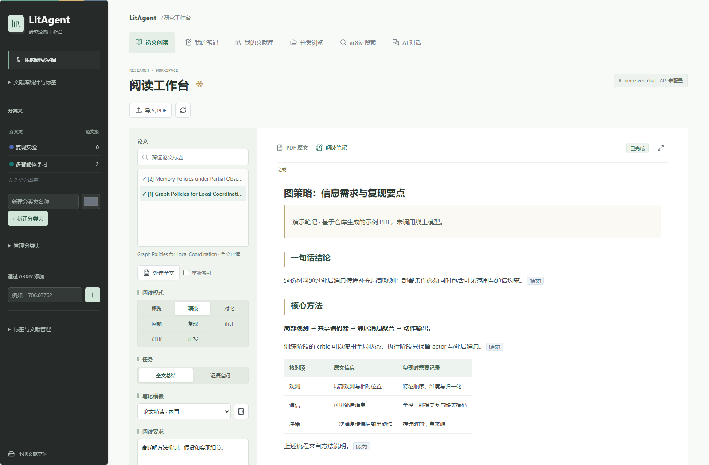
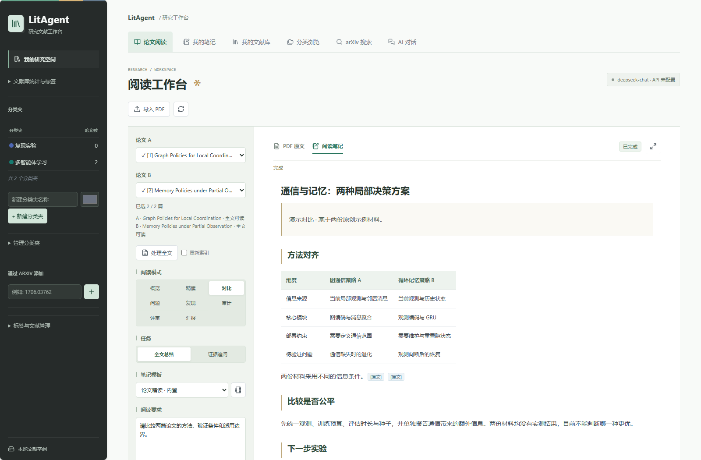
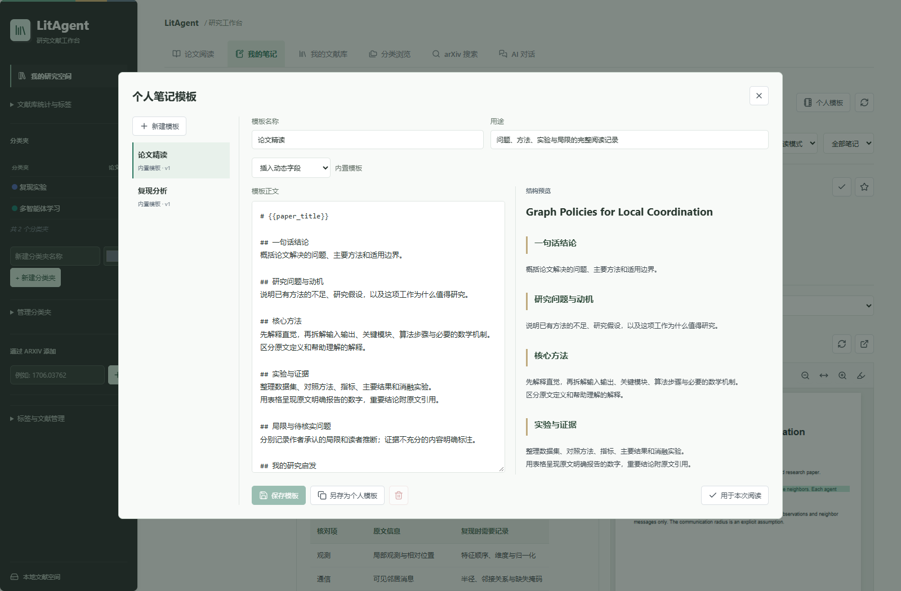
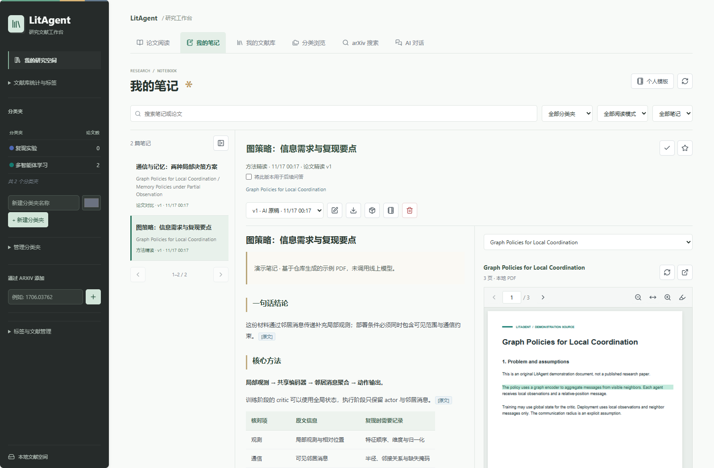
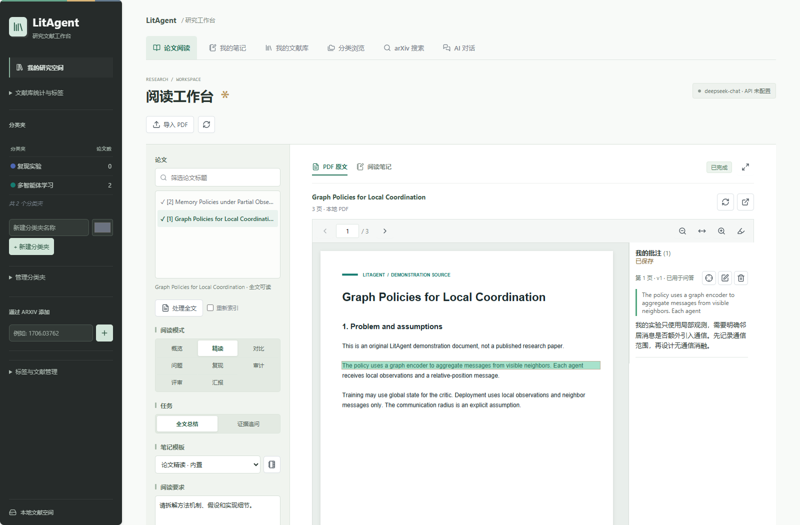
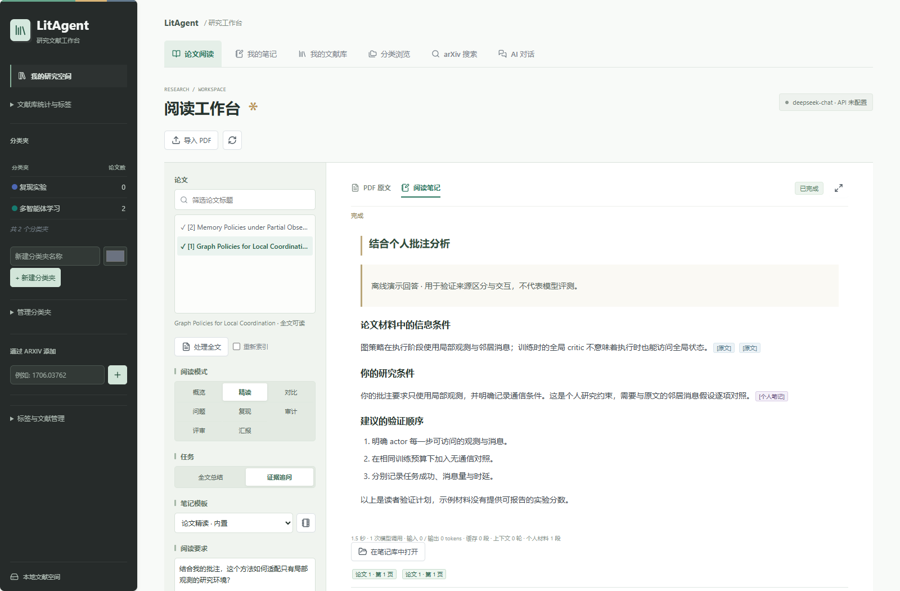

# 用户手册

首次安装见 [README](../README.md#快速开始)。本文从打开 `http://127.0.0.1:7860` 后开始。

## 首次配置 API

点击右上角“模型设置”，或未配置提示中的“配置 API”。从 DeepSeek 控制台创建自己的 API Key，填入服务地址、模型名称和密钥，再点击“测试连接”和“保存配置”。默认地址为 `https://api.deepseek.com`；模型名称以服务商当前提供的 ID 为准，测试返回的名称会出现在模型输入框候选中。

测试只查询模型列表，不生成内容、不发送论文。认证失败时核对密钥和地址；若提示模型不在列表中，改为可用模型后重试。实际阅读仍可能受余额、配额、服务兼容性等因素影响。

保存后不需要重启；新任务采用新配置，运行中的任务继续使用原配置。重新打开窗口不会回显密钥，留空保存代表保留现有密钥。更换服务地址时必须重新输入密钥。关闭窗口会清空尚未保存的密钥输入。

页面配置优先于 `.env`。点击“恢复环境配置”仅删除页面保存的配置；原 `.env` 不会被修改。密钥保存在本机 `data/model-config.json`（或 `LIT_DATA_DIR` 指定目录）的明文文件中，不存到浏览器，也不应上传或分享。API 配置与 E5 嵌入模型安装是独立步骤。

## 1. 准备论文

### 本地 PDF

在“论文阅读”点击“导入 PDF”，选择文字型文件。上传后会入库并创建全文处理任务。等待处理完成，再开始阅读。

如果文献已有 PDF，但尚未索引，选中论文后点击“处理全文”。“重新索引”用于主动重建；一般无需反复勾选。

PDF 预览不等于全文索引完成：预览只需要文件，问答还需要解析文字和检索索引。

### arXiv

在“arXiv 搜索”输入关键词，选择搜索结果加入文献库；也可以在侧栏输入 arXiv ID。选中文献后打开 PDF 预览，应用会在允许的 arXiv 来源下载并缓存文件。

其他网站的链接不会被任意代理下载。可以通过你有权访问的途径取得 PDF，再本地导入。

### 管理文献

“我的文献库”支持查看论文元数据、摘要、标签、分类与 PDF。“分类浏览”按分类夹展示。分类夹支持创建、重命名、颜色及增删归属；BibTeX 导出用于引用管理。

## 2. 保存研究档案

在“论文阅读”的“阅读档案”填写：

- 研究方向和阅读目的；
- 已有知识与需要重点解释的内容；
- 回答深度、语言；
- 可用算力、计划框架等复现条件。

可使用无人机强化学习、Agent 工程研究或组会准备预设，再按实际情况修改。**点击保存后才生效。**

例如“只有一张 GPU”是你的研究条件，不能被模型写成论文作者使用的配置。

## 3. 生成全文笔记



1. 选择全文已处理的论文。
2. 选择阅读模式，例如“精读”或“复现”。
3. 选择“全文总结”，填写本次要求。
4. 选择模板；没有自定义需求时可跟随阅读模式。
5. 点击“开始阅读”。

页面会显示分段阅读、补查、生成、核查等实际发生的阶段。完成后结果自动进入“我的笔记”。

“复用已提取的材料”可以重用相同配置下的分段材料；更改档案后最终笔记仍会重新生成。关闭该选项会重新取证，可能增加耗时和 API 消耗。

## 4. 查看依据与继续提问

点击回答中的“原文”，查看该片段及 PDF 页码。自动核查的“支持”只是模型的辅助判断，应检查数字、实验条件、因果关系是否得到原文支持。

切换“证据追问”，例如：

> 方法在训练和部署阶段分别需要哪些信息？论文有哪些证据支持这个结论？

同一范围内可连续追问“这个假设有什么限制”。切换论文或档案会隔离旧上下文；“新建阅读对话”可以主动清空追问上下文，已有笔记仍保留。

## 5. 比较两篇论文

选择“对比”后，分别选择论文 A 和论文 B。两篇都完成全文处理后开始阅读。

推荐要求：

> 比较研究问题、信息假设、方法机制、数据集、评估指标和适用边界。不同实验条件的数值请分开说明。

PDF 区域可以在 A/B 之间切换；原文预览切换不会改变阅读任务的论文选择。



## 6. 创建个人模板

打开“个人模板”，可选两版内置模板，或点击“新建模板”从空白开始。

一个简单的模板：

```markdown
# {{paper_title}}

## 我需要解决的问题
结合 {{research_domain}} 和 {{reading_purpose}} 描述阅读重点。

## 方法是如何工作的
先解释直觉，再说明机制、假设及关键步骤。

## 原文实验与证据
写明实验条件和主要结果，保留可核查引用。

## 对我的工作的启发
区分原文结论、个人推断和后续验证事项。
```

动态字段下拉框可以插入标题、作者、摘要、研究方向、阅读目的、算力等 20 个字段。它们填充已知资料，不自动产生研究结论。

保存后点击“用于本次阅读”。修改模板会产生新版本；旧笔记继续关联生成时使用的模板。



## 7. 整理笔记

在“我的笔记”可按正文、论文、分类夹或阅读模式查找笔记；支持收藏、标题修改、正文修订与版本历史。

- 保存修订会生成新版本，不覆盖旧正文。
- 回收站可以恢复笔记。
- 导出 Markdown 可保留脚注及原文链接。
- “导出笔记与 PDF”生成 ZIP 阅读包，包含原始 PDF、Markdown 和来源信息。
- “已人工核对原文，同意纳入训练样本”是单独的审核选项。正常保存笔记无需勾选，应用也不会自动训练模型。



## 8. 添加 PDF 批注

在任意内置 PDF 预览中选中当前页文字，点击出现的“添加批注”图标，填写个人评论、选择高亮颜色并保存。

高亮笔按钮打开批注列表。列表支持定位原文、编辑、删除和历史版本。选择旧版本后保存会生成新的修订记录。



批注保存在应用数据库中，原始 PDF 文件不改变。当前支持单页内多行文字；不支持跨页选区、手写画笔或扫描件文字识别。

如果提示“摘录未与解析原文匹配”，表示前后端提取结果未能对应，不能将摘录视为已核实证据；批注仍可保留用于个人记录。

## 9. 让个人笔记参与问答

有两处选择：

1. 在批注中勾选“用于后续问答”，或在“我的笔记”勾选“将此版本用于后续问答”。
2. 在“论文阅读”勾选“结合已选个人笔记与批注”。

然后提问：

> 结合我的批注，分析这篇论文是否适合我只有局部观测的部署条件。



回答分别展示“原文”和“个人笔记”引用。个人观点不会自动升级为论文事实。只有与本次论文范围相符的已选材料参与检索。

正文更新后必须重新选择新版本；停用或删除材料会影响新任务。历史回答保留生成时的引用快照，并提示来源是否已改变。

## 10. 任务与故障

| 情况 | 处理方法 |
|---|---|
| PDF 能预览，阅读却不可用 | 检查全文处理状态、本地嵌入模型和 API 配置 |
| 语义模型未就绪 | 安装 `requirements-rag.txt`，联网运行 `python -m scripts.setup_embeddings` |
| Hugging Face 无法连接 | 在可访问的网络完成模型下载，再回到离线运行；不要反复启动未完成的下载 |
| API 认证失败 | 在 `.env` 修改密钥后重启服务；健康检查只确认“已配置”，不验证额度 |
| 生成到一半失败 | 查看任务错误；区分输出长度截断、超时、网络和服务端错误，不能一律归因于上下文 |
| 任务超过预算 | 缩小阅读范围或先进行具体追问；失败读取任务可以重试 |
| 个人材料在生成中被修改 | 重新发起任务，使用最新材料 |
| 端口被占用 | 先确认原服务是否使用同一数据目录；不要同时启动两个进程访问同一 Qdrant 目录 |
| 更新后界面没有变化 | 重启后端，浏览器强制刷新；检查地址和端口 |

前台启动时按 `Ctrl+C` 停止。后台服务需要关闭对应的 LitAgent 进程；不要结束其他 Python 程序。

备份、恢复和自定义端口见 [部署指南](DEPLOYMENT.md)。为了保留笔记、批注与版本，不能只备份 PDF 文件。
